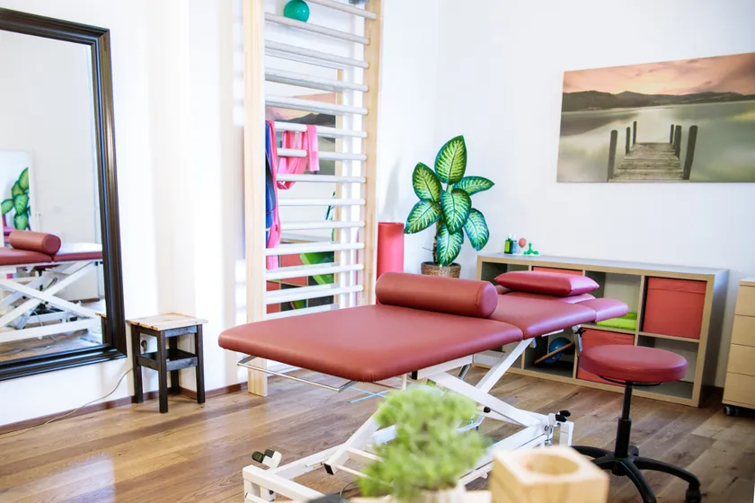
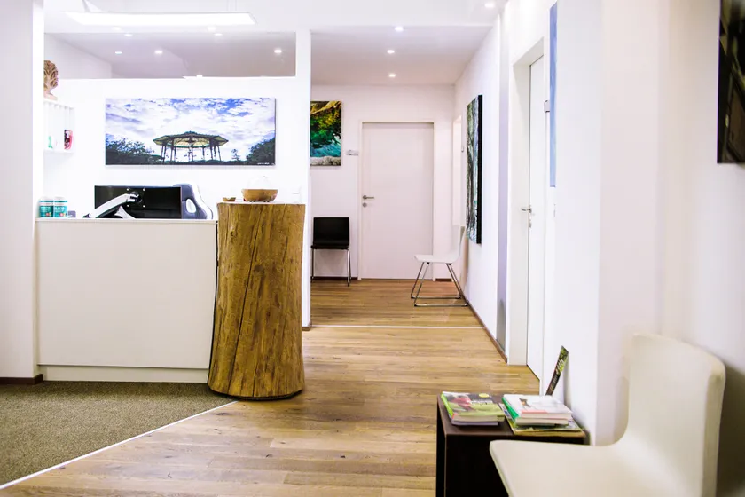

+++
title = "Infos zur Therapie"
date = "2026-04-09"
+++

Ich freue mich Sie in meiner Praxis begrüßen zu dürfen!

Bitte kommen Sie **rechtzeitig vor Therapiebeginn** in die Praxis. Die Therapie startet pünktlich.

**Parkplätze** sind rund ums Haus normalerweise kein Problem zu finden, jedoch kostenpflichtig (im Moment von 8-21 Uhr 2,20 Euro pro h).  Die Praxis ist aber auch **öffentlich super erreichbar** (Linie 3 Dr. Glatz- Strasse direkt vor der Haustür oder vom Hauptbahnhof zu Fuss in 15 min ).

Der **Eingang** befindet sich links vom M- Preis und rechts neben dem Bankomat der Tiroler Sparkasse. Bitte bei Bewusstseinsquelle läuten und warten bis ich die Tür öffne. Dann über die Stiegen oder den Lift in den 1. Stock und dort im großzügigen Wartebereich Platz nehmen bis ich Sie in den Behandlungsraum hole.

Wenn Sie zum ersten Mal bei mir sind liegt auf dem großem Baumstamm im Wartebereich ein **Fragebogen und die AGBs **bereit, diesen bitte noch vor der Therapie ausfüllen bzw. bestätigen.

Bitte nehmen Sie ein großes Badetuch oder ein **Leintuch** für die Therapieliege und die **ärztliche Verordnung** mit.

Kommen Sie in Unterwäsche in der Sie sich wohl fühlen und, falls vorhanden bitte nehmen Sie aktuelle Befunde mit.

Ich bin **Wahltherapeut**, dass heisst Sie bekommen für Physiotherapie im Nachhinein einen Teil refundiert (Höhe abhängig von der jeweiligen Krankenkasse aber ca. die Hälfte). Eine Zusatzversicherung deckt oft die restlichen Kosten (fragen Sie dazu bei dieser nach).

Die Osteopathie wird im Moment nur von eventuellen Zusatzversicherungen abgedeckt.

Beachten Sie auch noch meine [AGBs](/agbs)

