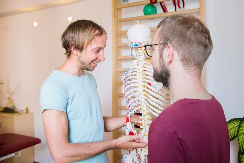

+++
title = "Vorträge und Workshops"
date = "2014-04-09"
+++

Seit 2010 bin ich in der Erwachsenenbildung als Referent an verschiedensten Institutionen. Auch während meiner Studienzeit habe ich schon diverse Sportkurse gehalten (seit 2006). 

Die Themen meiner Referententätigkeit sind breit gestreut in 
* der Massageausbildung
* der Physiotherapieausbildung
* der Pflegeassistenzausbildung 
* der Behindertenassistenzausbildung
* der Bacc. Ausbildung Pflege
* der Ausbildung für Instruktoren in verschiedenen Sportarten.

Ich habe schon unter anderem Vorträge und Workshops zum Thema 
* "gesunder Rücken" (Arbeitsgemeinschaft für Sport und Körperkultur in Österreich)
* "das Kreuz mit dem Kreuz -Heben und Tragen ohne Schaden" (Universität Innsbruck)
* "Vorsorge Aktiv" (Land Niederösterreich) 
* Seniorengymnastik im Altersheim (Sena Cura Grafenwörth)
* Anatomie für Yogalehrer:Innen (Yogaversity Lienz)
* Seniorengymnastik im Altersheim (Sena Cura Grafenwörth)
* Gesund in der Pflege (AK Bildungszentrum)
* Gesund im Beruf (ISD)

 abgehalten.

Es sind für mich aber natürlich auch auf Wunsch noch andere Themen denkbar die zu meinem beruflichen Background passen.

Falls Sie eine Anfrage zu einem Vortrag/Workshop mit mir haben so bitte ich Sie um Kontaktaufnahme unter 06504536498 oder markus.kienbacher@gmx.at

